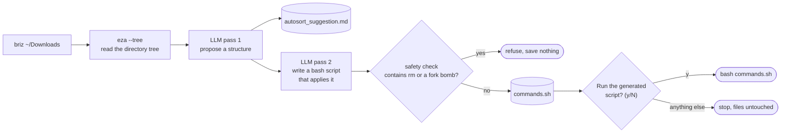

<div align="center">

<h1>Briz</h1>

<p><strong>Reorganize a messy directory with a local LLM.</strong></p>

<p>
  
  
  <a href="LICENSE"></a>
  
</p>

<p>
  <a href="#why">Why</a> ·
  <a href="#how-it-works">How it works</a> ·
  <a href="#installation">Installation</a> ·
  <a href="#usage">Usage</a> ·
  <a href="#safety">Safety</a> ·
  <a href="#configuration">Configuration</a>
</p>

</div>

Briz is a command-line tool that tidies a directory for you. It shows the directory tree to a
language model running on your own machine, asks it how the files should be organized, and
turns the answer into a shell script. Nothing moves until you have seen the plan and said yes.

> [!WARNING]
> Briz is experimental. Read the generated `commands.sh` before you let it run, and keep a
> backup of anything you care about.

## Why

Folders like `~/Downloads` or an old project directory pile up files faster than anyone sorts
them. Rule-based organizers (by extension or by filename pattern) need rules written up front,
and they can't tell that `invoice_march.pdf` and `receipt-0412.png` both belong under
"finances". A language model can make that kind of judgment from the names and the existing
structure, with no rules to maintain.

Briz uses a **local** model through [Ollama](https://ollama.com), so your file names never
leave your machine.

## How it works



1. **Read the tree.** Briz runs `eza --tree` on the target directory to get a readable
   snapshot of its layout.
2. **Plan.** The tree goes to the model with a request to reorganize it. The answer streams to
   your terminal as it is generated, and is saved to `autosort_suggestion.md`.
3. **Script.** A second prompt gives the model the tree and its own plan, and asks for *only* a
   bash script starting with `#!/bin/bash`. Briz cuts out everything before the shebang and
   after any closing Markdown fence.
4. **Check.** If the script contains `rm ` or `:(){`, Briz refuses to save it.
5. **Confirm.** The script is written to `commands.sh` (mode `0755`) and runs only if you
   answer `y`.

Splitting planning from scripting gives the model one job at a time. The plan is readable
prose you can judge on its own, and the script only has to translate a plan it already wrote.

## Requirements

- [Go](https://go.dev/dl/) 1.25 or later, to build
- [Ollama](https://ollama.com), running locally, with a model pulled (default: `mistral`)
- [eza](https://github.com/eza-community/eza), installed at `/opt/homebrew/bin/eza` (the
  Homebrew path on Apple silicon)

## Installation

```bash
git clone https://github.com/NoamFav/Briz.git
cd Briz
go build -o briz ./cmd/AutoSort
sudo mv briz /usr/local/bin/      # or anywhere on your PATH
```

## Usage

```bash
ollama pull mistral
cd ~                 # Briz writes its output files to the current directory
briz ~/Downloads
```

A session looks like this. The model's text streams live, so wording varies from run to run:

```text
$ briz ~/Downloads
Here is a suggested structure:

Downloads/
├── Documents/   invoices, contracts, PDFs
├── Images/      screenshots and photos
├── Installers/  .dmg and .pkg files
└── Archives/    .zip and .tar.gz files
...
#!/bin/bash
mkdir -p ~/Downloads/{Documents,Images,Installers,Archives}
mv ~/Downloads/*.pdf ~/Downloads/Documents/
...
Run the generated script? (y/N): n
```

After a run, the current directory contains:

| File | Contents |
| --- | --- |
| `autosort_suggestion.md` | The proposed structure, in prose |
| `commands.sh` | The script that applies it, ready to read, edit or run by hand |

To apply a plan later, or after editing it, run `bash commands.sh` yourself.

## Safety

Briz's guardrails are deliberately simple, so it is worth knowing exactly what they cover:

| Guardrail | What it catches | What it doesn't |
| --- | --- | --- |
| Confirmation prompt | Nothing runs unless you type `y` | Anything you approve without reading |
| `rm` filter | Scripts that delete files | `mv` onto an existing name, which overwrites |
| Fork-bomb filter | The classic `:(){ :\|:& };:` | Other harmful constructs |
| Local model | File names never leave your machine | — |

The safest workflow is to answer `n`, read `commands.sh`, and run it yourself.

## Configuration

| Variable | Default | Description |
| --- | --- | --- |
| `OLLAMA_MODEL` | `mistral` | Ollama model to query. Larger models produce more reliable scripts. |
| `OLLAMA_URL` | `http://127.0.0.1:11434` | Base URL of the Ollama server |

```bash
OLLAMA_MODEL=llama3.1:8b briz ~/Desktop
```

## Project structure

| Path | Description |
| --- | --- |
| `cmd/AutoSort/main.go` | The whole pipeline: tree, prompts, extraction, safety check, confirmation |
| `internal/llm` | Streaming client for Ollama's `/api/generate` |
| `internal/fileops`, `internal/rules`, `internal/sorter` | Placeholders for the native implementation below |
| `config/default_rules.yaml` | Placeholder for user-defined rules |

## Roadmap

- Move files natively in Go instead of generating bash, so every operation can be validated
- A real `--dry-run` that prints the moves without writing a script
- Rules in `config/default_rules.yaml` to pin certain files or folders in place
- Remove the hard dependency on `eza`

## License

Licensed under the [Apache License 2.0](LICENSE). See [NOTICE](NOTICE) for copyright
and attribution notices.
